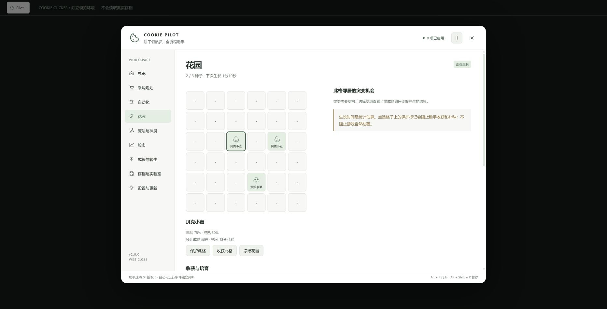
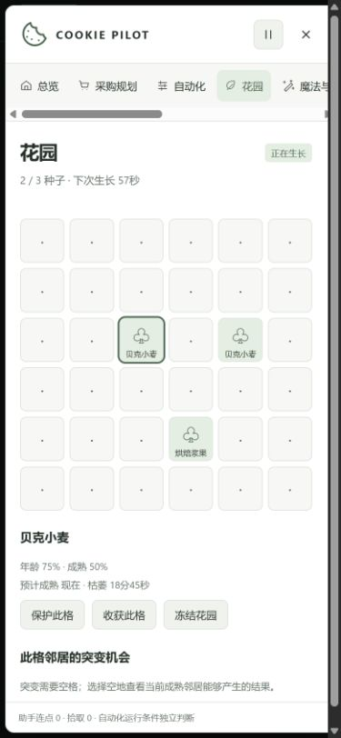
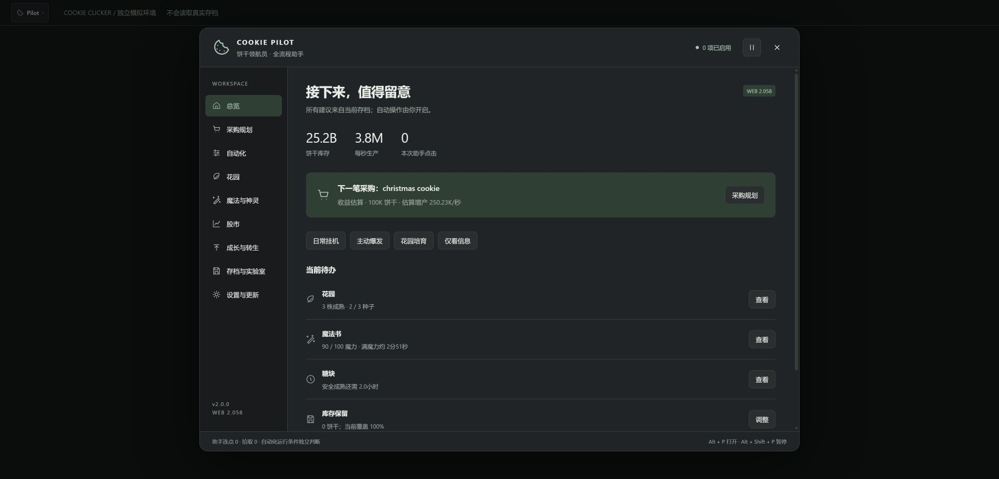

# Cookie Pilot 2.0.0 验证报告

日期：2026-11-17。目标接口：Cookie Clicker 官方网页 **2.058**。

## 已执行

| 层级 | 结果 | 覆盖 |
| --- | --- | --- |
| 核心与打包 | 35 项通过 | 配置、升级、预算、资源保护、跨系统规则、快照、更新元数据、脚本一致性、扩展权限和规则 |
| 官方函数对照 | 6 项通过 | 点击、花园、市场、万神殿、字符串 RNG、命运之手预测 |
| Chrome 交互 | 16 项通过 | 九模块、频率、暂停、事件、面纱、前期解锁、保护格、确认、补给失败、主题、重复加载和卸载恢复 |
| 额外界面检查 | 通过 | 暖白／石墨、真实点击确认取消、390×844 窄窗口，主内容无横向溢出 |

官方 RNG 对照包含 100 个种子 × 100 个随机值，10,000 个输出与当前游戏完全一致。法术预测包含 6 种季节 × 2 种 Dragonflight 状态 × 100 个施法序号，1,200 个结果与当前官方施法和金饼干初始化函数一致；这不代表未来版本或修改法术逻辑的 Mod 也适用。

官方函数只读下载到工作目录，在独立 VM 中配合隔离测试状态执行。原游戏文件不进入仓库或发行包。对照测试脚本随包提供，可通过 README 的参考脚本下载流程重复执行。

## 测试中修正的问题

- 市场价格应在市场 tick 回绕时采样，而不是每次计时器推进都采样。
- 没有启用规则时，不显示“另一标签页正在运行”。
- 预览服务器读取失败必须先返回 404，不能先发 200 再重复发送响应头。
- 临时安装页嵌入源码使用回调替换，避免源码中的 `$` 被当作替换模板。
- 保留详情展开状态、确认窗口鼠标事件和无点击挑战下的低频待机。
- 构建统一 LF 换行，保证 Windows 本地、Linux CI 与 GitHub 原始下载的哈希一致。

## 边界

本次没有把补给、自动购买或其他修改性测试运行在用户正在玩的真实存档上。Chrome 端到端测试使用自建的前期／后期模拟存档；官方函数对照使用下载的真实函数，但未启动包含全部素材和完整游戏循环的官方离线副本。因此不能把这些结果描述成所有后期组合和原游戏页面都已完整实测。

本地扩展清单和广告规则经过静态验证，尚未在用户浏览器安装扩展并抓取真实广告阻断记录。油猴通过管理器安装后自动升级到未来版本的完整周期，要等下一次版本发布才可实际观察；当前提供完整元数据、版本比较、校验信息和固定发布地址。

采购仍为明确标注的估算；花园尚不自动求解全种子最优路径；股市分位是本机样本；自动转生不启用，仅打开游戏确认。README 写明各模块的真实能力与条件。

## 界面留存

